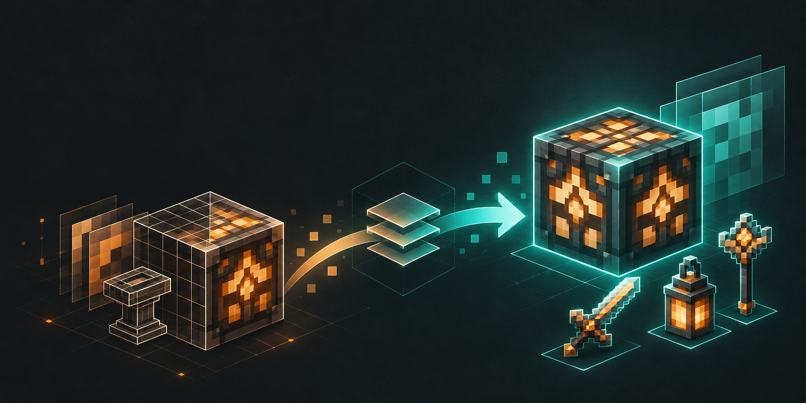
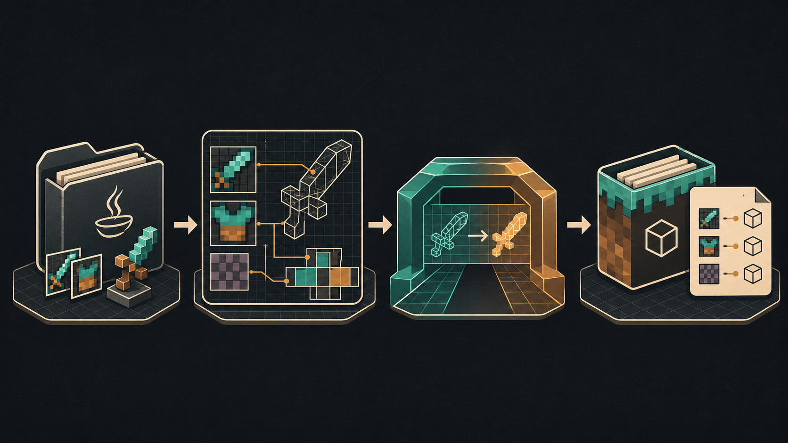

# NexoBedrock

<p align="center">
  
</p>

<p align="center">
  <a href="https://www.java.com/"></a>
  <a href="https://papermc.io/"></a>
  <a href="https://geysermc.org/"></a>
  
</p>

**English:** [Read the English documentation](#english)

**Português:** [Leia a documentação em português](#português)

---

## English

NexoBedrock converts resource packs generated by [Nexo](https://nexomc.com/) into a Bedrock resource pack (`.mcpack`) and Geyser custom item mappings, so supported Nexo items can be displayed by Bedrock clients.

It targets Paper/Purpur 1.21+ and Java 21. The plugin listens for Nexo's `NexoPostPackGenerateEvent` and reads the generated assets before obfuscation when available. It can also read Nexo's final `pack.zip` as a fallback.

<p align="center">
  
</p>

### Features and limitations

Supported:

- 2D item icons and 3D item models, including geometry, attachables, and display transforms.
- Bow and crossbow pull/charged model variants.
- Nexo `CustomArmor` layers for helmets, chestplates, leggings, and boots. Inventory icons and equipped armor textures are converted separately.
- Legacy `custom_model_data` and modern `item_model` mappings (Geyser custom mappings v2).
- Parent models, texture variables, `texture_size`, multi-texture atlases, and rotated faces.

Not supported (reported as `unsupported` rather than stopping the whole conversion):

- Custom blocks and blockstates.
- Elytra, capes, and custom entity models.
- Furniture, display entities, item frames, and other entities.
- Fonts, glyphs, GUIs, menu icons, and sounds.
- Bedrock client-side animated textures; only the first frame is used.
- Custom item components/attributes in Geyser and full `composite` / `select` model handling. Where possible, the first model is used as an approximation and a warning is reported.
- ModelEngine and other model plugins.

### Requirements

- Paper or Purpur 1.21+
- Java 21
- Nexo installed and generating a resource pack
- Geyser-Spigot, or Geyser on a proxy with its pack and mappings directories configured
- Floodgate is optional

### Build and install

Build the plugin:

```bash
gradle build
```

Copy `build/libs/NexoBedrock-<version>.jar` to the server's `plugins/` directory and start the server. Review `plugins/NexoBedrock/config.yml`, then run `/nexobedrock convert` or let automatic conversion run when Nexo generates its pack.

The plugin writes the Bedrock pack and mappings to the configured Geyser directories. Use `/geyser reload` to reload Geyser; some Geyser versions may require a full restart to reload custom mappings.

### Commands

Permission: `nexobedrock.admin` (OP by default). Aliases: `/nb`, `/nexob`.

| Command | Description |
| --- | --- |
| `/nexobedrock convert [--force]` | Convert the pack asynchronously. `--force` bypasses the cache. |
| `/nexobedrock status` | Show configuration, conversion state, and the latest statistics. |
| `/nexobedrock reload` | Reload `config.yml`. |
| `/nexobedrock report` | Summarize the latest report, including skipped item reasons. |

### Configuration

Relative paths are resolved from the server root. The following excerpts show the main options; the generated config contains defaults and comments.

```yml
enabled: true
auto-convert-on-pack-generate: true

source:
  pack-path: "plugins/Nexo/pack/pack.zip"
  assets-path: "plugins/Nexo/pack/assets"
  prefer-assets-on-event: true

geyser:
  packs-folder: "plugins/Geyser-Spigot/packs"
  mappings-folder: "plugins/Geyser-Spigot/custom_mappings"
  pack-name: "nexobedrock"
  restart-geyser: false
  reload-command: "geyser reload"
  create-folders: true
  backup: true
  backup-keep: 10
  attachable-material: "entity_alphatest_one_sided"

conversion:
  include-2d: true
  include-3d: true
  max-pack-size-mb: 100
  debug: false
  mapping-mode: "legacy"
  namespace: "nexobedrock"
  creative-category: "items"
  display-handheld: "auto"
  min-engine-version: [1, 20, 0]
  max-atlas-tiles: 64
  max-atlas-tile-size: 256
  keep-output-copy: true
```

- `source.pack-path`: final Nexo pack, used by manual conversion and as a fallback.
- `source.assets-path`: pre-obfuscation assets, preferred during the Nexo event when enabled.
- `geyser.packs-folder` / `geyser.mappings-folder`: destination directories for Geyser.
- `geyser.backup`: backs up existing pack and mappings before replacement.
- `mapping-mode`: `legacy` uses `custom_model_data`; `modern` uses `item_model`; `auto` chooses based on the item definition.
- `namespace`: Bedrock item namespace; it cannot be `minecraft`.
- `creative-category`: one of `all`, `construction`, `nature`, `equipment`, `items`, `item_command_only`, or `none`.
- `display-handheld`: `auto`, `true`, or `false`.
- `max-pack-size-mb`: input/output size limit. If the generated pack exceeds it, existing Geyser files are left untouched.
- `max-atlas-tiles` / `max-atlas-tile-size`: protect against unusually large texture atlases.
- `keep-output-copy`: also keeps a copy under `plugins/NexoBedrock/output/`.

### Generated files

In Geyser's configured directories:

```text
packs/nexobedrock.mcpack
custom_mappings/nexobedrock.json
```

Under `plugins/NexoBedrock/`, the plugin can keep backups, a conversion cache, an optional output copy, timestamped reports, and temporary work files. Temporary files are removed after conversion unless debug mode is enabled.

The `.mcpack` includes item icons, converted 3D atlases and geometry, item attachables and animations, armor attachables and equipped textures, a manifest, and a pack icon. Geyser mappings use schema v2 (`format_version: 2`).

### Conversion overview

1. Snapshot Nexo items through its public API.
2. Read models, item definitions, textures, and texture metadata from the resource pack.
3. Resolve model parents, texture variables, legacy overrides, and modern custom-model-data range dispatches.
4. Generate item icons and, for 3D items, Bedrock geometry, atlases, attachables, and display animations. For Nexo armor, keep the GUI icon separate from the equipped armor layer and create an attachable for the corresponding equipment slot.
5. Generate Geyser mappings and publish the pack and mappings using temporary files and atomic moves where supported, keeping backups of prior files.
6. Write a per-item conversion report.

Heavy conversion work runs asynchronously. Nexo API snapshots and final callbacks run on the server's main thread.

Java model UVs are interpreted in the 0–16 coordinate space and scaled by `texture_size`. Rotated faces are remapped in the texture atlas; rotated elements become parented Bedrock bones. For animated Java textures, the MVP uses the first frame.

### Reports and safety

Each item is reported as `converted`, `unsupported`, `skipped`, or `failed`. An isolated item failure does not stop other items. Reports include the source, hash, duration, statistics, item results, warnings, errors, and output paths. Use `/nexobedrock report` for a summary.

The pack and mappings are staged before replacement. If conversion produces no supported items, exceeds the configured size limit, or deployment fails, existing Geyser files are preserved or restored. The cache is keyed by the input pack, relevant configuration, armor definitions, and plugin version.

### Development and tests

```bash
gradle test
gradle build
```

An optional smoke test can run against a real Nexo pack when those assets are available locally:

```bash
NEXOBEDROCK_SMOKE=true \
NEXOBEDROCK_SMOKE_PACK=/path/to/Nexo/pack.zip \
NEXOBEDROCK_SMOKE_ASSETS=/path/to/Nexo/pack/assets \
gradle test --tests 'dev.nexobedrock.SmokeRealPackTest'
```

Smoke-test output is written under `build/`, not into the source pack.

### Independence, support, and license

- **Independent project:** NexoBedrock is developed independently and without a profit motive. No original source code from the Nexo plugin, Scaffolding, or the ScaffoldingExtension was copied or used. This project is not affiliated with, endorsed by, or an official product of their developers.
- **Support for NexoBedrock:** For bugs, setup questions, or other issues with this plugin, [open an issue in this repository](https://github.com/Tascok/NexoBedrock/issues). Do not contact Nexo or Scaffolding support for NexoBedrock issues; those teams are not responsible for this project.
- **Upstream projects (reference links only):** [Nexo plugin](https://nexomc.com/products/nexo) · [Scaffolding addon](https://nexomc.com/products/scaffolding) · [Scaffolding documentation and companion extension](https://docs.nexomc.com/addons/scaffolding).
- **License:** This repository does not currently include a `LICENSE` file. Please clarify the project's license before redistributing it or accepting contributions that may have licensing requirements.

The Nexo and Scaffolding names and trademarks belong to their respective owners.

---

## Português

O NexoBedrock converte resource packs gerados pelo [Nexo](https://nexomc.com/) em um pack Bedrock (`.mcpack`) e em custom mappings do Geyser, para que itens suportados do Nexo apareçam corretamente em clientes Bedrock.

O plugin é direcionado ao Paper/Purpur 1.21+ e Java 21. Ele escuta o evento `NexoPostPackGenerateEvent` do Nexo e, quando disponível, lê os assets gerados antes da obfuscação. Também pode ler o `pack.zip` final do Nexo como alternativa.

<p align="center">
  
</p>

### Funcionalidades e limitações

Suportado:

- Ícones 2D e modelos de itens 3D, incluindo geometria, attachables e transformações de exibição.
- Variações de modelo de carregamento/disparo para arco e besta.
- Camadas `CustomArmor` do Nexo para capacetes, peitorais, calças e botas. Ícones de inventário e texturas equipadas são convertidos separadamente.
- Mappings legados `custom_model_data` e modernos `item_model` (custom mappings v2 do Geyser).
- Modelos-pai, variáveis de textura, `texture_size`, atlas com múltiplas texturas e faces rotacionadas.

Não suportado (registrado como `unsupported`, sem interromper toda a conversão):

- Blocos customizados e blockstates.
- Elytra, capas e modelos de entidades customizadas.
- Móveis, display entities, molduras de itens e outras entidades.
- Fontes, glifos, GUIs, ícones de menu e sons.
- Animações de textura no cliente Bedrock; somente o primeiro frame é usado.
- Componentes/atributos customizados de itens no Geyser e suporte completo a modelos `composite` / `select`. Quando possível, o primeiro modelo é usado como aproximação e um aviso é registrado.
- ModelEngine e outros plugins de modelos.

### Requisitos

- Paper ou Purpur 1.21+
- Java 21
- Nexo instalado e gerando um resource pack
- Geyser-Spigot ou Geyser em um proxy com as pastas de pack e mappings configuradas
- Floodgate é opcional

### Compilar e instalar

Compile o plugin:

```bash
gradle build
```

Copie `build/libs/NexoBedrock-<versão>.jar` para a pasta `plugins/` do servidor e inicie-o. Confira `plugins/NexoBedrock/config.yml` e execute `/nexobedrock convert`, ou deixe a conversão automática acontecer quando o Nexo gerar o pack.

O plugin grava o pack Bedrock e os mappings nas pastas configuradas do Geyser. Use `/geyser reload` para recarregá-lo; algumas versões do Geyser podem exigir reinicialização completa para carregar custom mappings.

### Comandos

Permissão: `nexobedrock.admin` (OP por padrão). Aliases: `/nb`, `/nexob`.

| Comando | Descrição |
| --- | --- |
| `/nexobedrock convert [--force]` | Converte o pack em segundo plano. `--force` ignora o cache. |
| `/nexobedrock status` | Mostra a configuração, o estado da conversão e as estatísticas mais recentes. |
| `/nexobedrock reload` | Recarrega `config.yml`. |
| `/nexobedrock report` | Resume o relatório mais recente, incluindo motivos de itens ignorados. |

### Configuração

Caminhos relativos são resolvidos a partir da raiz do servidor. Os trechos abaixo mostram as opções principais; o arquivo gerado contém valores padrão e comentários.

```yml
enabled: true
auto-convert-on-pack-generate: true

source:
  pack-path: "plugins/Nexo/pack/pack.zip"
  assets-path: "plugins/Nexo/pack/assets"
  prefer-assets-on-event: true

geyser:
  packs-folder: "plugins/Geyser-Spigot/packs"
  mappings-folder: "plugins/Geyser-Spigot/custom_mappings"
  pack-name: "nexobedrock"
  restart-geyser: false
  reload-command: "geyser reload"
  create-folders: true
  backup: true
  backup-keep: 10
  attachable-material: "entity_alphatest_one_sided"

conversion:
  include-2d: true
  include-3d: true
  max-pack-size-mb: 100
  debug: false
  mapping-mode: "legacy"
  namespace: "nexobedrock"
  creative-category: "items"
  display-handheld: "auto"
  min-engine-version: [1, 20, 0]
  max-atlas-tiles: 64
  max-atlas-tile-size: 256
  keep-output-copy: true
```

- `source.pack-path`: pack final do Nexo, usado na conversão manual e como alternativa.
- `source.assets-path`: assets anteriores à obfuscação, preferidos durante o evento quando habilitado.
- `geyser.packs-folder` / `geyser.mappings-folder`: pastas de destino do Geyser.
- `geyser.backup`: faz backup do pack e dos mappings existentes antes de substituí-los.
- `mapping-mode`: `legacy` usa `custom_model_data`; `modern` usa `item_model`; `auto` escolhe com base na definição do item.
- `namespace`: namespace dos itens Bedrock; não pode ser `minecraft`.
- `creative-category`: uma destas opções: `all`, `construction`, `nature`, `equipment`, `items`, `item_command_only` ou `none`.
- `display-handheld`: `auto`, `true` ou `false`.
- `max-pack-size-mb`: limite de tamanho de entrada/saída. Se o pack gerado exceder o limite, os arquivos existentes do Geyser são preservados.
- `max-atlas-tiles` / `max-atlas-tile-size`: protegem contra atlas de textura excepcionalmente grandes.
- `keep-output-copy`: também mantém uma cópia em `plugins/NexoBedrock/output/`.

### Arquivos gerados

Nas pastas configuradas do Geyser:

```text
packs/nexobedrock.mcpack
custom_mappings/nexobedrock.json
```

Em `plugins/NexoBedrock/`, o plugin pode manter backups, cache de conversões, uma cópia opcional da saída, relatórios com timestamp e arquivos temporários. Os arquivos temporários são removidos após a conversão, exceto quando o modo debug está habilitado.

O `.mcpack` inclui ícones, atlas e geometria de itens 3D, attachables e animações dos itens, attachables e texturas equipadas de armadura, manifesto e ícone do pack. Os mappings do Geyser usam o schema v2 (`format_version: 2`).

### Como a conversão funciona

1. Captura os itens do Nexo pela API pública.
2. Lê modelos, definições de itens, texturas e metadados de textura do resource pack.
3. Resolve modelos-pai, variáveis de textura, overrides legados e `range_dispatch` moderno de custom model data.
4. Gera ícones e, para itens 3D, geometria Bedrock, atlas, attachables e animações de exibição. Para armaduras do Nexo, mantém o ícone de inventário separado da camada equipada e cria um attachable para o slot correspondente.
5. Gera os mappings do Geyser e publica pack e mappings usando arquivos temporários e movimentação atômica quando disponível, mantendo backups dos arquivos anteriores.
6. Escreve um relatório de conversão por item.

O trabalho pesado da conversão roda em uma thread assíncrona. A captura da API do Nexo e os callbacks finais rodam na thread principal do servidor.

As UVs dos modelos Java são interpretadas no espaço 0–16 e escaladas por `texture_size`. Faces rotacionadas são remapeadas no atlas; elementos rotacionados viram bones Bedrock parentados. Para texturas Java animadas, o MVP usa o primeiro frame.

### Relatórios e segurança

Cada item recebe o status `converted`, `unsupported`, `skipped` ou `failed`. Uma falha isolada não interrompe os demais itens. Os relatórios incluem fonte, hash, duração, estatísticas, resultados por item, avisos, erros e caminhos de saída. Use `/nexobedrock report` para ver um resumo.

O pack e os mappings são preparados antes da substituição. Se nenhum item suportado for convertido, o limite de tamanho for excedido ou a publicação falhar, os arquivos existentes do Geyser são preservados ou restaurados. O cache considera o pack de entrada, configurações relevantes, definições de armadura e versão do plugin.

### Desenvolvimento e testes

```bash
gradle test
gradle build
```

Um smoke test opcional pode ser executado com um pack Nexo real disponível localmente:

```bash
NEXOBEDROCK_SMOKE=true \
NEXOBEDROCK_SMOKE_PACK=/caminho/para/Nexo/pack.zip \
NEXOBEDROCK_SMOKE_ASSETS=/caminho/para/Nexo/pack/assets \
gradle test --tests 'dev.nexobedrock.SmokeRealPackTest'
```

As saídas do smoke test ficam em `build/`, sem alterar o pack de origem.

### Independência, suporte e licença

- **Projeto independente:** O NexoBedrock é desenvolvido de forma independente e sem objetivo de lucro. Nenhum código-fonte original do plugin Nexo, do Scaffolding ou do ScaffoldingExtension foi copiado ou utilizado. Este projeto não é afiliado, endossado nem um produto oficial de seus desenvolvedores.
- **Suporte ao NexoBedrock:** Para bugs, dúvidas de instalação ou outros problemas com este plugin, [abra uma issue neste repositório](https://github.com/Tascok/NexoBedrock/issues). Não procure o suporte do Nexo ou do Scaffolding para problemas do NexoBedrock; as equipes deles não são responsáveis por este projeto.
- **Projetos upstream (links apenas para referência):** [Plugin Nexo](https://nexomc.com/products/nexo) · [Addon Scaffolding](https://nexomc.com/products/scaffolding) · [Documentação do Scaffolding e extensão complementar](https://docs.nexomc.com/addons/scaffolding).
- **Licença:** Este repositório ainda não contém um arquivo `LICENSE`. Defina a licença do projeto antes de redistribuí-lo ou aceitar contribuições que possam ter requisitos de licenciamento.

Os nomes e marcas Nexo e Scaffolding pertencem aos seus respectivos proprietários.
